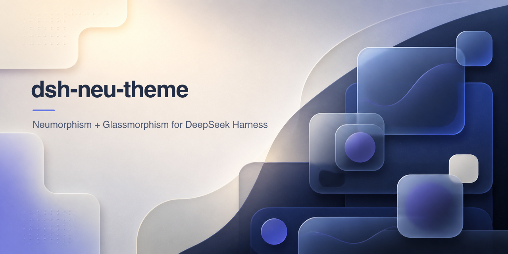
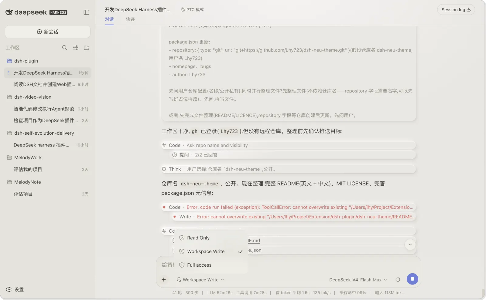
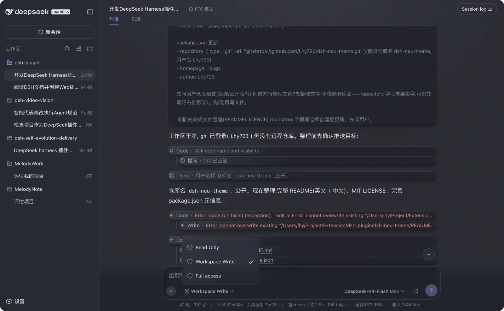

<p align="center">
  
</p>

# dsh-neu-theme

[](https://www.npmjs.com/package/dsh-neu-theme)
[](https://www.npmjs.com/package/dsh-neu-theme)

**DeepSeek Harness Web 与嵌入式 Desktop 工作区的轻拟物(Soft-UI)主题插件**——奶油浅色与墨蓝深色两套配色,
完整的光影、材质、纹理、磨砂玻璃与微交互动画。

English version: [README.md](README.md)。

## 特性

- **两套主题**注册进内置 ThemeRuntime:
  - `neu-light` — 奶油暖白画布,柔和灰蓝点缀
  - `neu-dark` — 墨蓝夜画布,幽光靛紫点缀
- **光影** — 环境顶光 + 角落补光,铺在真实可见的表面(对话画布、侧边栏、细节面板)
- **材质** — 三层阴影(接触影 + 投影 + 顶边高光)、145° 光泽渐变对齐光源方向、
  代码块背光内壁
- **纹理** — 细腻灰度噪点(内联 SVG feTurbulence)覆盖画布、侧边栏、细节面板与代码块
- **磨砂玻璃** — 输入栏与它的弹出层(权限菜单、模型菜单、上下文面板)共享同一套
  玻璃语言:输入栏的模糊放在 `::before` 伪元素层,弹层保留自己的真实
  `backdrop-filter` 模糊(卡片不再是它们的 backdrop root)
- **微交互动画** — 对话节点挂载淡入、气泡 hover 上浮、输入区聚焦凹陷加深、
  工具行与思考行 hover 增强;全部受 `prefers-reduced-motion` 保护
- **设置入口** — 设置 → 通用 → Neumorphism theme(Default / Neu Light / Neu Dark),
  选择通过当前 profile 的 volatile 插件 Config 保存
- **默认即原生** — 选 Default(或从未选择)时,页面与 dsh 原生完全一致:
  不注入样式、不打 body 标记、原生颜色与阴影

## 预览

### Neu Light

<p align="center">
  
</p>

### Neu Dark

<p align="center">
  
</p>

## 安装

从 npm 安装已发布的包到所用的 dsh profile（DSH Web 用 `web`，Desktop 用 `desktop`）：

```sh
# DSH Web
dsh plugin --profile web add dsh-neu-theme
# DSH Desktop
dsh plugin --profile desktop add dsh-neu-theme
# 或手动安装到 Web profile：
cd ~/.dsh/profiles/web
pnpm add dsh-neu-theme
```

这个包也可以在 [npm](https://www.npmjs.com/package/dsh-neu-theme) 查看。

然后把 `"dsh-neu-theme"` 加入所选 profile `package.json` 的
`dsh.profile.bundles`,并重启对应的 `dsh web` 或 DSH Desktop。

本地开发时，可以安装本地路径：

```sh
cd ~/.dsh/profiles/web
pnpm add file:/path/to/dsh-neu-theme
```

使用:**设置 → 通用 → Neumorphism theme** 选择 **Default / Neu Light / Neu Dark**。
选择是一个 volatile 插件 Config 字段，DSH 会将它保存到当前 profile 的
Cordis patch 中；Web 与 Desktop profile 分别保存自己的选择。选择
**Default** 即回到内置外观。DSH 0.2 会把旧 `settings.yaml` 分区导入到 id 相同的 profile entry；
entry id `dsh-neu-theme` 因此保留了旧设置键的导入路径。

## 平台兼容性

`dsh-neu-theme` 是 Web 客户端插件（`dsh.client.platform: "web"`）。DSH Desktop 主窗口嵌入完整的 DSH Web 应用，因此主题通过 Web 客户端插件加载器作用于主工作区。Desktop 使用独立的 `desktop` profile；使用桌面版时应安装到该 profile。本插件只调整嵌入式工作区的界面样式，不提供原生菜单、托盘或窗口壳扩展。本版本要求 DSH `^0.2.0-rc.2`。DSH 0.2 将旧的 `settings.register()` / `settingsScope` API 替换为插件 `Config` 与 `configForms`；本版本不支持 DSH 0.1 runtime。

## 开发

```sh
npm run build   # 从 src/client.tpl.js + themes/*.json 重新生成 lib/client.js
npm run check   # 语法与 DSH 0.2 兼容契约检查
```

`dsh web` 运行期间,HMR 链会轮询 `lib/client.js`,重建后只热重载本插件。

## 仓库结构

```
dsh-neu-theme/
├── package.json          # dsh.bundle.patch + dsh.client 清单
├── cordis.patch.yml      # loader entry 插入(id: dsh-neu-theme)
├── themes/               # neu-light.json / neu-dark.json — 调色板
├── src/
│   ├── index.js          # Host Config schema 与 profile 设置策略
│   └── client.tpl.js     # 浏览器半模板(构建时注入主题)
├── scripts/build.mjs     # 零依赖构建脚本
└── lib/                  # 生成产物(git 忽略)
```

## License

MIT

